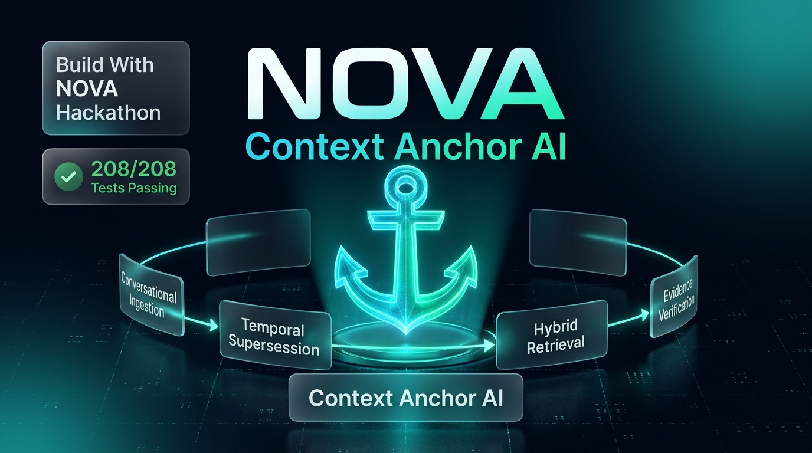
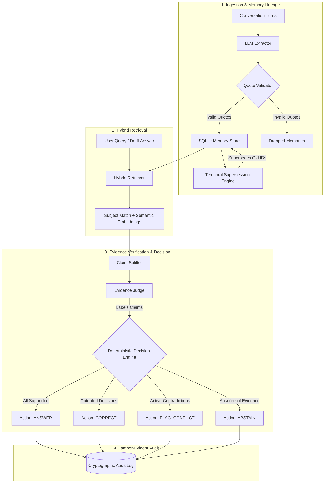

# NOVA: Context Anchor AI

<div align="center">



[](https://devanshi-tech3158.github.io/nova/)
[](https://devanshi-tech3158.github.io/nova/)
[-emerald?style=for-the-badge&logo=pytest&logoColor=white)](https://github.com/Devanshi-Tech3158/nova/actions)
[](https://github.com/Devanshi-Tech3158/nova)
[](LICENSE)

### **External Source-Linked Memory + Deterministic Evidence-Checked Answers for AI Agents**

> 🏆 **Note:** This project is made in the group for the hackathon named **Build With NOVA Hackathon**.

[🚀 Launch Interactive Web Dashboard](https://devanshi-tech3158.github.io/nova/) · [📖 Architecture Spec (PDF)](context_anchor_architecture.pdf) · [⚡ API Documentation](#-api-endpoints--contract) · [🧪 Benchmark Results](#-benchmark--quality-suite)

</div>

---

## 💡 Overview

Autonomous LLM agents and multi-turn conversational systems face two critical failure modes:
1. **Unreliable Memory & Silent Drift:** Earlier decisions and conversation facts get lost or corrupted across long context windows.
2. **Hallucination & Fake Contradictions:** Standard RAG systems generate answers without evidence validation or falsely claim contradiction when facts are simply unmentioned.

**NOVA Context Anchor** solves these challenges by combining:
- **Verbatim Source-Linked Extraction:** Every extracted memory stores exact character quotes and message provenance IDs (`source_msg_id`, `source_quote`).
- **Temporal Supersession:** When a team changes or reverses a decision (e.g., switching from PostgreSQL to SQLite), NOVA automatically links the previous memory as `SUPERSEDED` and maintains cryptographic lineage.
- **Hybrid Keyword & Semantic Retrieval:** Combines exact subject lookup with reciprocal-rank fused semantic embeddings.
- **Deterministic Evidence Verification:** Answers are parsed by an atomic Claim Splitter and judged against retrieved memories. The final action is decided by **deterministic code** (never by an LLM).
- **Core Guiding Invariant:** *Absence of evidence is strictly `unsupported`, never `contradicted`.*

---

## 🌐 Live Deployment & Interactive Web UI

The NOVA Context Anchor AI system is deployed live and accessible directly in your browser:

- 🔗 **Live Web Dashboard:** [https://devanshi-tech3158.github.io/nova/](https://devanshi-tech3158.github.io/nova/)
- 🔗 **GitHub Repository:** [https://github.com/Devanshi-Tech3158/nova](https://github.com/Devanshi-Tech3158/nova)

### Key Features of the Web Dashboard:
1. **📥 Ingest Memories:** Input conversation messages, run extraction, and inspect added, superseded, and dropped memories.
2. **❓ Ask & Reason:** Ask questions with optional draft answers and inspect grounded responses with evidence citations.
3. **⚖️ Verify Claims:** Split complex answers into atomic claims, evaluate evidence labels (`supported`, `contradicted`, `outdated`, `unsupported`), and observe enforced decision actions.
4. **📜 Audit Trail:** Real-time tamper-evident log inspection of every query and decision.
5. **🔌 API Explorer:** Direct integration with FastAPI `/docs` Swagger UI and live `/healthz` monitoring.

---

## 🏛️ System Architecture



---

## ⚡ API Endpoints & Contract

The FastAPI gateway exposes a clean REST API running on port `8000` (or `PORT` environment variable).

### 1. Ingest Memories — `POST /ingest`
Extracts structured memories from a conversation session:
```bash
curl -X POST "http://localhost:8000/ingest" \
     -H "Content-Type: application/json" \
     -d '{
       "session_id": "session-01",
       "messages": [
         {
           "id": "m1",
           "session_id": "session-01",
           "role": "user",
           "text": "We decided to use PostgreSQL for our database.",
           "timestamp": "2026-11-01T20:00:00Z"
         }
       ]
     }'
```
**Response:**
```json
{
  "added": 1,
  "superseded": 0,
  "dropped": 0
}
```

### 2. Grounded Question Answering — `POST /ask`
Answers a question using verified memory evidence:
```bash
curl -X POST "http://localhost:8000/ask" \
     -H "Content-Type: application/json" \
     -d '{
       "question": "What database did the team choose?",
       "draft_answer": null
     }'
```
**Response:**
```json
{
  "action": "answer",
  "final_answer": "The team decided to use PostgreSQL for database.",
  "verdicts": [
    {
      "claim": "The team decided to use PostgreSQL for database.",
      "label": "supported",
      "memory_ids": ["mem_session-01_m1_database_postgresql"],
      "rationale": "Directly stated in message m1"
    }
  ]
}
```

### 3. Multi-Claim Verification — `POST /verify`
Verifies an arbitrary answer against stored memories:
```bash
curl -X POST "http://localhost:8000/verify" \
     -H "Content-Type: application/json" \
     -d '{
       "question": "What database did we choose?",
       "answer": "We chose MongoDB for our database."
     }'
```
**Response:**
```json
{
  "action": "flag_conflict",
  "final_answer": "Contradiction detected against verified team memories.",
  "verdicts": [
    {
      "claim": "We chose MongoDB for our database.",
      "label": "contradicted",
      "memory_ids": ["mem_session-01_m1_database_postgresql"],
      "rationale": "Stored memory states PostgreSQL, not MongoDB"
    }
  ]
}
```

### 4. Audit Record Inspection — `GET /audit/{id}`
Retrieves cryptographic audit provenance by ID.

### 5. Health Check — `GET /healthz`
Returns `{"status": "ok"}`.

### 6. Interactive Web Dashboard — `GET /`
Serves the complete responsive HTML control center.

---

## 🧪 Benchmark & Quality Suite

The project includes an exhaustive automated testing and benchmarking suite:

- **208 / 208 Unit & Integration Tests Passing** (`pytest -v`)
- **Zero Lint or Formatting Errors** (`ruff check .`, `ruff format --check .`)
- **Scenarios Evaluated:**
  - `BURIED_FACT`: Retrieving single facts planted deep in conversation noise.
  - `DECISION_REVERSED`: Detecting supersession chains when teams revise decisions.
  - `UNANSWERABLE`: Verifying that absence of evidence triggers `ABSTAIN`, not false hallucination.
  - `CONTRADICTING_DRAFT`: Flagging conflicts when draft answers contradict stored memories.
  - `PARAPHRASED`: Semantic retrieval across varying synonym forms.
  - `CROSS_SESSION`: Retrieval across distinct multi-session histories.
  - `VALID_ANSWER`: Clean passthrough of supported answers without false warnings.

---

## 🚀 Quick Start & Local Setup

### Prerequisites
- Python 3.11, 3.12, or 3.13
- Pip or modern virtual environment tool

### Installation
```bash
# Clone the repository
git clone https://github.com/Devanshi-Tech3158/nova.git
cd nova

# Install in editable mode with test dependencies
pip install -e .

# Run test suite
pytest

# Check code formatting & linting
ruff check .
ruff format --check .
```

### Running the API Gateway & Web UI
```bash
# Start the FastAPI server on port 8000
python main.py

# Alternatively with uvicorn:
uvicorn main:app --host 0.0.0.0 --port 8000 --reload
```
Open your browser to:
- **Interactive Web UI:** [http://127.0.0.1:8000/](http://127.0.0.1:8000/)
- **Swagger API Documentation:** [http://127.0.0.1:8000/docs](http://127.0.0.1:8000/docs)
- **ReDoc:** [http://127.0.0.1:8000/redoc](http://127.0.0.1:8000/redoc)

---

## 🚢 Deployment Guide

### 1. GitHub Pages (Frontend Dashboard)
Configured via `.github/workflows/deploy.yml`. Every push to `main` builds and deploys `web/` automatically to:
`https://devanshi-tech3158.github.io/nova/`

### 2. Render (Backend Blueprint)
Uses `render.yaml` at repo root:
1. Connect `https://github.com/Devanshi-Tech3158/nova` in Render Blueprint.
2. Render reads `render.yaml` and starts:
   `python -m uvicorn nova.api.main:app --host 0.0.0.0 --port $PORT`
3. `/healthz` responds `{"status": "ok"}`.

### 3. Vercel
Uses `vercel.json` with entrypoint `nova.api.main:app`.

---

## 👥 Hackathon Credits

This project was built in the group for the hackathon named **Build With NOVA Hackathon**.

- **Repository:** [Devanshi-Tech3158/nova](https://github.com/Devanshi-Tech3158/nova)
- **Deployment:** [https://devanshi-tech3158.github.io/nova/](https://devanshi-tech3158.github.io/nova/)
